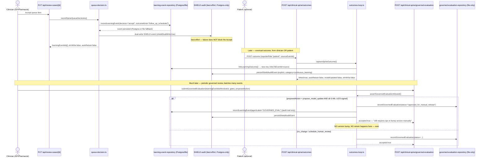
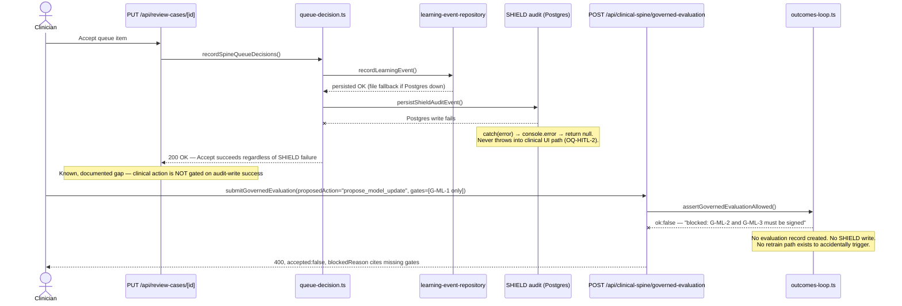

# Volume I Draft Audit + Outcomes End-to-End

**Audited document:** `docs/volume-i/VOLUME_I_PRODUCT_REQUIREMENTS.md`, v0.21 ("draft complete — chapter-by-chapter"), 22/22 chapters `[DRAFTED]`, none `Accepted`.
**Method:** light-read + grep-heavy — full read of §0 (Document Control) and the §0.7 revision history (which is itself an unusually detailed self-audit trail), plus full reads of Chapters 5, 14, and the first two journeys of 15, and Chapter 20; targeted grep passes for chapter boundaries, `[TODO]` residue, `OQ-*` ids, agent-naming, and the diabetes-signals-not-agents framing across all 22 chapters; direct code reads of the outcomes/learning-loop stack and the two governance docs it must not contradict.
**Not done (by design, per the brief):** a full line-by-line read of all ~4,560 lines; no code changes; no rewriting of Volume I content.

---

## Part 1 — Volume I chapter audit

### Overall verdict

This is an unusually disciplined draft for a document at "draft complete, unreviewed" status. It is self-auditing by construction: every chapter states its own honest Exists/Partial/Missing/GAP findings, cites the exact file(s) it was grounded in, and the §0.7 revision history is effectively a second, chapter-by-chapter audit trail already written by whoever drafted it. The dominant risk is **not** hallucinated capability — spot-checks against `outcomes-loop.ts`, `learning-loop.ts`, `learning-event-repository.ts`, `queue-decision.ts`, and both governance docs confirm the document's claims about the continuous-learning loop are accurate, including subtle details (literal `FALSE,FALSE,FALSE,TRUE` SQL constants, the best-effort SHIELD write, the three-gate G-ML sequence). The real risks are (a) **document hygiene drift** accumulated over 22 sequential single-chapter drafting passes (stale forward cross-references, physical ordering that doesn't match chapter numbering), and (b) the fact that **"DRAFTED" reads as much more finished than "reviewed" or "true tomorrow"** — a Cursor prompt that treats any FR block as a ready-to-implement spec without checking the chapter's own honesty caveats risks building against an aspirational/future-phase requirement as if it were current-state.

Usable for Cursor: **yes, with discipline** — the doc's own §0.3 instruction ("never implement Volume I wholesale, always scope to a reviewed FR/AC block") is correct and necessary, and is not optional given how many FRs in later chapters are explicitly `[FUTURE]`/`v1`/`future`-phased inside a chapter otherwise marked `[DRAFTED]`.

### Part A — Foundations (Ch. 1–5)

| Ch | Status quality | Strengths | Gaps / contradictions | Top risk if implemented blindly |
| --- | --- | --- | --- | --- |
| 1 Product Vision | Drafted to spec depth; foundational BO/NO/SC used correctly by every later chapter | Clear Non-Objectives (NO-1…9) that everything downstream correctly treats as hard constraints | None found | Someone treats an SC (`[ASPIRATIONAL — NEEDS BASELINE]`) as already true |
| 2 Scope & Non-Scope | Drafted early (v0.1), thin relative to later chapters' depth | Non-scope items (NS-*) genuinely used later (NS-9 second disease module, NS-4 synthetic-only data) | Written before the numbering/status conventions matured in later chapters — style is slightly less rigorous than Ch. 5+ | Low — mostly boundary-setting, low implementation surface |
| 3 Personas & Stakeholders | Solid, grounded in real RBAC code (`permission-matrix.ts`, `user-scope.ts`) | Honest about `patient`/`researcher` `AppRole` mapping gap (OQ-PER-1/2) — a real, live security-relevant gap, not cosmetic | `patient`/`researcher` still default to `clinical_reviewer` in code per the doc's own finding — a genuine risk, correctly flagged, **not yet closed** | Building a new patient-facing feature assuming proper RBAC scoping when the default-role fallback is actually wrong |
| 4 Platform Architecture | Drafted after Ch. 5 (see Cross-chapter findings) | Ties directly to the Layer Map ADR rather than re-deriving layer status | Physically appears *after* Ch. 5 in the file despite being numbered Ch. 4 (see below) | Minor — a reader skimming top-to-bottom hits Ch. 5 first without warning |
| 5 Clinical Safety & HITL | The most rigorous chapter reviewed directly; matches code closely (verified against `human-gates.ts`, `queue-decision.ts`, `outcomes-loop.ts`, `shield-audit-repository.ts`) | Explicitly separates item-level disposition (Accept/Edit/Reject) from case-level gates (`HumanGateId`) — this distinction is real in code and the doc gets it exactly right; honestly flags the SHIELD best-effort-write gap (OQ-HITL-2) as **binding, must-fix-before-pilot**, not papered over | §5.11 cross-references still say "Chapter 4 … `[TODO]`" and "Chapter 8 … `[TODO]`" even though both are now DRAFTED (stale forward-reference, not retroactively fixed) | Someone reads §5.11 and concludes Ch. 4/8 don't exist yet, or skips reading them because the pointer looks unfinished |

### Part B — Platform Capabilities (Ch. 6–7)

| Ch | Status quality | Strengths | Gaps | Top risk |
| --- | --- | --- | --- | --- |
| 6 Core Platform Capabilities | Well-grounded (`auth.ts`, `consent.ts`, `emis-staging.ts`) | Clear purpose-bound consent model (`allowsClinicalWrite:false`) | Retention policy for revoked consent/superseded samples unspecified (OQ-CORE-4) | Assuming consent revocation aborts in-flight runs (it doesn't — additive/non-aborting per OQ-CORE-2) |
| 7 Universal Agent Platform | Strong — canonical `AGENT_DIRECTORY` naming resolved explicitly | Confirms PRISM/ATLAS are Phase 2, not built — prevents scope creep | Legacy aliases (ORACLE/EQUITY/REFERRAL) still used ~25× alongside canonical names (HORIZON/COMPASS/PATHWAY) — intentional per DEC-008, but a future contributor could reintroduce the legacy name as if canonical | Building a new feature against `ORACLE` naming when `HORIZON` is canonical, fragmenting the codebase's own naming discipline |

### Part C — Disease Intelligence: Diabetes (Ch. 8–9)

| Ch | Status quality | Strengths | Gaps | Top risk |
| --- | --- | --- | --- | --- |
| 8 Disease Intelligence — Diabetes | Largest, most detailed chapter; correctly frames **diabetes as 9 signals, not 9 agents** (DEC-009) — verified consistent everywhere else in the doc | Restates the spec's 6 open questions rather than re-deciding them (correct discipline) | v0→v1 wiring "not started" — a load-bearing fact for Ch. 14/15/20's honesty findings | Building v1-assuming code against a v0-only reality; treating Insulin/GLP-1 `null`-type locks as guidance rather than hard type locks |
| 9 Digital Twin — Diabetes | Honest about `physiologicalTwin:false` and that no Diabetes-specific twin exists — only a generic, heart-failure-flavoured rules ranker | Explicit two-phase split (near-term extension vs. much-later "Target Twin") prevents conflating the two | None found beyond open questions already correctly logged | Assuming "Digital Twin" chapter existing means a working diabetes simulator exists |

### Part D — Intelligence Layers (Ch. 10–14)

| Ch | Status quality | Strengths | Gaps | Top risk |
| --- | --- | --- | --- | --- |
| 10 Population Intelligence | Honest that ICS's 47,832-patient number is an illustrative, disconnected fixture, and that even the "live" Neo4j path reads pre-seeded aggregates, not a computed pipeline | Segment→Predict→Recommend→Monitor→Learn framing used consistently by Ch. 14/15 later | Neither Segment nor Predict is a real computed stage | Presenting the ICS dashboard as reflecting the platform's actual ~100-patient cohort |
| 11 Patient Intelligence | Brutally honest Exists/Partial/Missing per capability (Gamification/Goals/Family = zero code) | States the absolute no-self-prescribe rule cleanly | Patient self-report check-in has no backing API — yet later assumed as a precondition in Journey 3 (Ch. 15) | Building a patient check-in feature assuming Chapter 3's persona narrative describes an existing surface |
| 12 Clinical Intelligence | Names the three-way (later four-way, per Ch. 18 correction) split GP surface honestly | Good cross-reference discipline pointing back to Ch. 5's gate catalogue rather than re-deriving it | The "single unified clinician workspace" vision is explicitly **not** delivered — three/four separate surfaces | Assuming a Timeline→Evidence→Agents→Approvals single workspace exists when a GP actually navigates three-plus screens |
| 13 Research Intelligence | Honest that 4 of 6 vision capabilities have zero code | Flags a real architecture bug: the research-evaluation endpoint's role check bypasses the canonical permission matrix (OQ-RES-1) | Same as above — a genuine, not-yet-fixed security finding | Treating "Research Intelligence" chapter's existence as evidence the six Owkin-style capabilities are built |
| 14 Continuous Learning | Directly verified against code — **accurate**. Correctly separates the six delivered stages (Clinician→Validation) from the three "Improve" stages, which are gate-checked process with **zero demonstrated release history** | `FR-LEARN-025/026` ("architectural absence," not a flippable default) is a genuinely strong, code-verified claim | None found in the reviewed section; this chapter is a model for the rest of the Volume | Believing "Continuous Learning" chapter existing means the platform has ever actually shipped a model update through G-ML-1/2/3 — it has not, ever, as of this Volume |

### Part E — Experience & Workflows (Ch. 15–18)

| Ch | Status quality | Strengths | Gaps | Top risk |
| --- | --- | --- | --- | --- |
| 15 Workflows & User Journeys | Journey 1 and 2 (directly read) are precise, step-level, and honestly labeled `[LIVE]`/`[PARTIAL]` | Resolves two previously-deferred open questions (out-of-hours escalation, Ch. 8 EC-DIAB-5 / Ch. 11 OQ-PAT-6) in one place rather than leaving them dangling twice | Journey 3 depends on Ch. 11's not-yet-built patient self-report API — correctly flagged inline, easy to miss if only skimming the step table | Implementing Journey 3 end-to-end assuming Step 2 (patient self-report) already has a route |
| 16 Business Rules Catalog | Strong consolidation; top-8 hard-constraint quick-reference (§16.1) is exactly the right "read this first" artefact | Explicit conflict-resolution rule (hard constraint always wins) | None found in the reviewed section | Treating a `future`-phase BR as `now`-binding because it's in the same catalogue as `now` rules |
| 17 Data Expectations | Named honestly: no `glucose` modality exists yet; diabetes readings are typed placeholders | Good sensitivity/retention tiering | Retention *periods* per tier still undefined (defers to Compliance) | Assuming a shared canonical data-dictionary module exists — it doesn't; entities are defined independently across two files |
| 18 UI / Screen Definitions | 59-screen catalogue, corrects Ch. 12's 3-surface finding to 4 | Absolute FR-UI-061 (no patient-role control can submit a dose-change) is a strong, testable rule | None found beyond what's already flagged | Assuming screen catalogue existing means each screen is behaviourally tested — only 2 of 59 have accessibility coverage |

### Part F — Quality & Governance (Ch. 19–22)

| Ch | Status quality | Strengths | Gaps | Top risk |
| --- | --- | --- | --- | --- |
| 19 Non-Functional Requirements | Three-way honesty tag (`[MEASURED]`/`[ASPIRATIONAL]`/`[PROCESS GATE]`) applied to all 60 NFRs — good discipline | No load test, no uptime SLA, no LLM latency baseline exist — stated plainly | None found | Quoting an NFR number as a real SLA in a partner conversation |
| 20 Acceptance & Validation | Directly verified — accurate and specific (e.g. eval harness genuinely covers 3 of 12 agents; zero Diabetes signal-builder unit tests) | Seven-level validation hierarchy + explicit Definition-of-Done for Cursor-delivered changes (§20.5) is directly actionable | Traceability matrix (`QA_TRACEABILITY_MATRIX.md`) still uses a pre-Volume-I `REQ-<nnn>` scheme with **zero** rows citing a Volume I `FR-*`/`AC-*` id — the two systems don't talk to each other yet | Assuming a `PASS` in the QA matrix maps to a specific Volume I FR — there is currently no link |
| 21 Open Questions / Decisions Log | Genuinely useful consolidation — 118 OQs into one backlog, 22 decisions registered, and it does its own de-duplication work (see below) | Already found and flagged 4-way (`OQ-ARC-2`/`OQ-POP-1`/`OQ-BR-3`/`OQ-DATA-3`) and 2-way (`OQ-HITL-2`/`OQ-BR-2`) duplicate OQs itself — no extra de-dup work needed from this audit | Proposes but doesn't execute a sign-off mechanism (§21.10) | None significant — this chapter does its job |
| 22 Appendices | Reference-only, as intended; introduces no new requirements | Clean glossary + hard-constraints one-pager (Appendix E) is a good "print this and pin it" artefact | None found | None significant |

### Cross-chapter consistency findings

1. **Agent naming is consistent.** HORIZON/COMPASS/PATHWAY are used as canonical throughout; legacy aliases (ORACLE/EQUITY/REFERRAL, ~25 occurrences) are consistently flagged as legacy internal ids per the documented rename map (Appendix D, DEC-008), not accidentally mixed in as if canonical.
2. **"Diabetes = 9 signals, not 9 agents" is consistent** everywhere it's invoked (DEC-009), including in Ch. 14's flywheel table and Ch. 4/8's architecture framing. No drift found.
3. **Duplicate Open Questions exist but are self-flagged, not silently duplicated.** The k-anonymity threshold appears under four ids (`OQ-ARC-2`/`OQ-POP-1`/`OQ-BR-3`/`OQ-DATA-3`) and the SHIELD-write gap under at least two (`OQ-HITL-2`/`OQ-BR-2`, with Ch. 14 and Ch. 5 both citing `OQ-HITL-2` as the canonical owner). Chapter 21 already performs this de-duplication (§21.8) — this is good hygiene already in place, not a new finding, but worth confirming a **future Chapter 21 revision actually resolves them to one id** rather than leaving the de-dup note as permanent scaffolding.
4. **Stale forward cross-references are a systemic, Volume-wide pattern, not an isolated Ch. 5 issue.** Because chapters were drafted sequentially (one per revision, §0.7) and each chapter's cross-reference section was written pointing at whatever chapters existed *at that time*, essentially every chapter's cross-references to chapters drafted **later** still say `[TODO]` (concrete instances found by grep: Ch. 3→Ch. 5/8, Ch. 4→Ch. 6/7/8, Ch. 5→Ch. 4/8, Ch. 6→Ch. 7/8/9, Ch. 8→Ch. 9, Ch. 15's EC-FLOW-5→Ch. 18, Ch. 17→Ch. 19/22). None of these are contradictions of fact — the referenced chapters are genuinely drafted now — but a reader following a cross-reference literally will think the target chapter doesn't exist. **Recommend a single find-and-fix pass across all `, \`[TODO]\`)` cross-reference tags once Volume I enters review**, rather than treating each as a separate defect.
5. **Physical chapter ordering in the file does not match chapter numbering for Ch. 4/5.** Chapter 5 (HITL) appears physically *before* Chapter 4 (Platform Architecture) in the file (line ~489 vs. ~673), because Ch. 5 was drafted first (v0.3) and the file was never reordered to match the Table of Contents' logical sequence. Every chapter's own numbered header is correct (`## 5. Chapter 5 —`, `## 6. Chapter 4 —`) so no id is wrong, but a linear top-to-bottom read hits Ch. 5 before Ch. 4. Low severity, easy fix (move the section), worth doing before external `.docx` export (§0.3).
6. **Honesty-field vocabulary (`ehrWrite`, `hitlRequired`, `autoRetrain`, `liveEmis`, `physiologicalTwin`, `modelUpdated`) is used identically everywhere it appears**, matching the actual TypeScript literal-type fields in code. No drift found — this is the single most consistently-enforced piece of vocabulary in the whole Volume.
7. **"DRAFTED" chapters routinely contain `[FUTURE]`/`v1`/`future`-phase sub-content.** This isn't a defect — it's the doc's stated design (§0.1) — but it is the single easiest thing for someone skimming a chapter's `[DRAFTED]` tag to miss: a chapter being fully specified does not mean every requirement in it describes today's system.

### Top 5 risks if Volume I is implemented from blindly (Deliverable A summary)

1. Treating a `[DRAFTED]` chapter tag as equivalent to "current-state, ready to build" rather than "fully specified, including future phases, still unreviewed."
2. Following a stale `[TODO]` cross-reference and concluding a chapter doesn't exist or skipping it.
3. Building on the `patient`/`researcher` RBAC role gap (Ch. 3, OQ-PER-1/2) as if it were already closed — it is a real, live security-relevant gap.
4. Assuming the SHIELD audit trail is guaranteed-durable — it is explicitly a best-effort write today (OQ-HITL-2), and this Volume itself calls this a must-fix-before-pilot item, not a cosmetic one.
5. Treating the eval harness's "PASS" (3 of 12 agents) or the QA traceability matrix's `PASS` rows as broader coverage than they are — neither currently maps to a specific Volume I `FR-*`/`AC-*` id, and the agent-eval harness explicitly does not cover 9 of the 12 named agents.

---

## Part 2 — Outcomes end-to-end (product + code)

### 1. Trigger

Two distinct triggers exist, and the code treats them differently:

- **Care-action trigger (the "prediction → decision" half):** a clinician's Accept / Edit / Reject on an individual review-queue item, via `PUT /api/review-cases/[id]` → `recordSpineQueueDecisions()` (`lib/clinical-spine/queue-decision.ts`). This always fires a `LearningEvent` with `decision` set, regardless of outcome.
- **Outcome-capture trigger (the "what actually happened" half):** a *separate*, later action — `POST /api/clinical-spine/outcomes` → `captureSpineOutcome()` — invoked by a clinician confirming a follow-up **or** a patient self-reporting an observational outcome on the Patient Companion surface (`reporterRole: "clinician" | "patient" | "admin"`). This is the literal meaning of "outcomes" in this codebase: it is not automatic, it requires a distinct human action against a specific prior `learningEventId`.

### 2. Data written

| What | Where | Notes |
| --- | --- | --- |
| The original care-action row | `aksh.learning_events` (Postgres) or `data/learning-events*.json` (file fallback) | `LearningEvent` schema (`lib/clinical-proof/learning-loop.ts`): `decision`, `agentLabel`, `predictionId`, `outcomeKind` (defaults `unknown`), honesty fields |
| The eventual-outcome row | Same table, **new row**, `linksToEventId` pointing at the source | Never an `UPDATE` of the source — append-only by construction (`buildLinkedOutcomeEvent` throws if you try to link an outcome onto an outcome) |
| Honesty flags | Literal, hard-coded on every row/response: `autoRetrainTriggered:false`, `modelUpdated:false`, `ehrWrite:false`, `hitlRequired:true` | On the Postgres path these are **literal SQL constants** in the INSERT (`FALSE, FALSE, FALSE, TRUE`), not bound parameters — a materially stronger guarantee than an app-level default |
| SHIELD audit mirror | `aksh.shield_audit_events` (durable, hash-chained) | Dual-written from the learning-event repository (`shieldDualWrite`) **and** separately, explicitly, from `outcomes-loop.ts` for outcome captures and governed evaluations |
| Governed evaluation record | `data/governed-evaluations*.json` (file-only store — no Postgres path exists for this one) | `GovernedEvaluationRecord`: gates array, `gatesAllSigned`, `proposedAction`, `status` |

### 3. Relationship to Accept/Edit/Reject and `HumanGateId` gates

These are **two distinct, independently-tracked mechanisms** that both exist in the code and are correctly kept distinct by Chapter 5 of Volume I:

- **Item-level disposition** (`Accept`/`Edit`/`Reject`) is the base primitive on an individual queue item. It is what creates the `LearningEvent` in the first place. Handled by `queue-decision.ts`.
- **Case-level `HumanGateId` gates** (`red_flag_escalation`, `referral_pathway`, `medication_decision`, `lib/human-gates.ts`) are a *separate* case-completeness check, derived from safety flags, not from the learning-event/outcomes system at all. `deriveHumanGates()` never reads or writes a `LearningEvent`.
- **They do not block each other in code.** A case can have all its queue items Accepted (and learning events recorded) while a case-level gate is still `required` — Chapter 5's own FR-HITL-008 states the case is not "finalization-ready" in that state, but nothing in `outcomes-loop.ts` or `queue-decision.ts` checks gate status before recording a learning event or accepting an outcome. **This is a real, code-verified honesty point:** outcome capture does **not** require a case's `HumanGateId` gates to be cleared first — the two systems are decoupled in the current implementation, and Volume I does not claim otherwise (it only claims finalization/export is blocked, not that learning-event/outcome recording is blocked).

### 4. SHIELD audit vs. learning events — two trails?

**Effectively yes, feeding one physical ledger.** There are two conceptually distinct trails, but they converge into a single durable table:

- **The Learning Event trail** (`aksh.learning_events` / file fallback) is a purpose-built, structured schema for the prediction→decision→outcome lifecycle: decision type, outcome kind, linkage, model version. It has its own durable store with a genuine two-tier fallback (Postgres → file), so it **cannot silently disappear** the way SHIELD writes can.
- **The SHIELD trail** (`aksh.shield_audit_events`) is the platform's single, hash-chained, append-only audit ledger for *everything* — case-level gate decisions, item-level dispositions, learning-event captures, and governed evaluations all mirror into it. Every learning-event write and outcome capture separately calls `persistShieldAuditEvent`.
- **The asymmetry that matters:** `persistShieldAuditEvent` is explicitly a **best-effort, Postgres-only** write — "if the Postgres write fails, the function catches the error, logs it, and returns `null`... never throws into clinical UI paths" (verified directly in `shield-audit-repository.ts` and restated almost verbatim in Volume I Ch. 5 §5.4 as a **binding, must-fix-before-pilot gap**, `OQ-HITL-2`). The Learning Event write, by contrast, has a genuine file-system fallback and is comparatively more durable than its own SHIELD mirror. In other words: **the audit copy of an outcome capture is less durable than the outcome capture itself** — a real, current-state gap, not a hypothetical one.

### 5. How outcomes feed evaluation / G-ML gates

`submitGovernedEvaluation()` (`outcomes-loop.ts`) takes a batch of `learningEventIdsReviewed` plus a `proposedAction` (`no_change` / `schedule_human_review` / `propose_model_update`) and a `rationale`. It:

- **Blocks** `propose_model_update` outright (`assertGovernedEvaluationAllowed`) unless all three of `G-ML-1`/`G-ML-2`/`G-ML-3` are `signed:true` (checked in-process, not merely documented).
- Records the evaluation to an append-only, **file-only** store (`governed-evaluation-repository.ts` — this one has no Postgres path at all, unlike learning events).
- Even when fully approved (`status:"approved_for_manual_release"`), the function **only records approval for manual release** — it has no code path that bumps a version, flips a flag, or calls anything outside its own recorder. The actual release is a separate, human-operated checklist per `docs/GOVERNED_MODEL_RELEASE_SOP.md` (target version string, eval report, hazard-log update, rollback plan, CSO + release-authority sign-off) executed **entirely outside this code**.

### 6. What does NOT happen (verified, not assumed)

- **No silent retrain, ever.** `autoRetrainTriggered`/`modelUpdated` are `false` as a **type-level literal** (`false as const`) on every object this loop can produce — there is no code path, not even inside `submitGovernedEvaluation`'s "approved" branch, that can set either to `true`. This matches Volume I Ch. 14's FR-LEARN-025/026 exactly.
- **No EHR write.** `ehrWrite:false` is asserted the same way; `captureSpineOutcome`/`submitGovernedEvaluation` never call anything under `bridge-staging.ts`/`medplum-client.ts`.
- **No case-level gate is touched.** Nothing in the outcomes/learning-loop code reads or writes `HumanGateDecision`.
- **As of this Volume's drafting, no agent version, twin rule-weight, or disease-module model has ever actually been bumped through G-ML-1/2/3 in this build.** The mechanism is unit-tested (`clinical-spine-phase-e.test.ts`, `CP-LEARN-001`); it has zero production release history. This is Volume I's own honest finding (Ch. 14 §14.7) and the code review here found nothing to contradict it.

### 7. Gaps between Volume I (Ch. 14/15/20) and actual code

All confirmed, not new findings — Volume I already states each of these; listed here because the user asked for ruthless honesty about partial/best-effort capture:

- **SHIELD best-effort write (§5.4, OQ-HITL-2)** — confirmed directly in code; a clinical Accept/Edit/Reject or an outcome capture can succeed even if its SHIELD mirror silently fails.
- **Outcome capture is optional and unprompted, not enforced.** Nothing in the code requires an eventual outcome to ever be captured for an "awaiting_outcome" care action — `loopCompleteRatio` can sit indefinitely below 1.0, by design, and Volume I is explicit that this must never auto-close (FR-LEARN-014). This means **"outcomes" in this platform is genuinely best-effort/self-serve**, not a guaranteed-complete loop — worth stating plainly since the user asked for ruthlessness here.
- **The "immediate outcome" classification on Reject is a labeling convenience, not a captured real-world outcome.** `queue-decision.ts` sets `outcomeKind:"care_action_deferred"` automatically on every Reject, which `classifyCareAction()` then treats as `loopStage:"immediate_outcome"` (closed) — **without any human ever reporting what actually happened**. Only `Accept` (→ `follow_up_scheduled`) and `Edit` (→ `unknown`) leave the action genuinely `awaiting_outcome`. This is a reasonable clinical design (a rejected draft has nothing to follow up on) but it means the platform's own `loopCompleteRatio` metric is partly an artifact of how many drafts get rejected, not purely a measure of genuine outcome-capture completeness — a nuance neither the code comments nor Volume I currently spell out explicitly, and worth a one-line doc clarification.
- **`submitGovernedEvaluation` has no Postgres path** (file-store only) — a durability asymmetry with learning events (which do have Postgres+file) that Volume I does not currently call out explicitly, even though it calls out the SHIELD asymmetry.
- **No cross-tenant check confirmed on `learningEventIdsReviewed`** in `submitGovernedEvaluation` (Ch. 14 OQ-LEARN-2, code review here did not find one either) — a real, open, unresolved gap.
- **Diabetes module has zero unit tests and zero wiring into this loop** — Ch. 14 §14.8's framing (routes through the same loop once wired) is correct as a *design intent*, but there is nothing yet to verify since the module isn't wired (Ch. 20's own finding, confirmed).

### 8. Sequence diagrams

**Happy path — Accept → eventual outcome → governed evaluation:**

**Fail-safe path — SHIELD write failure and blocked model-update:**

---

## Summary of the two ruthless-honesty findings the parent should surface first

1. **Outcome capture is opt-in and self-reported, not guaranteed or enforced** — a care action can sit `awaiting_outcome` forever with nothing forcing closure, and a Reject is auto-classified as "closed" without any real-world follow-up ever happening.
2. **The audit copy of a clinical or outcome event is less durable than the event itself** — SHIELD is a best-effort, Postgres-only write that can silently fail while the underlying clinical action and its learning-event record both succeed (learning events have a genuine file fallback; SHIELD does not).
